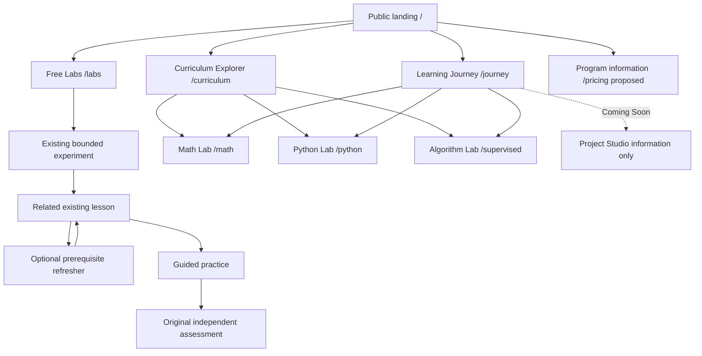

# Public and learner navigation architecture

Proposed, pending founder approval. Existing routes and evidence ownership remain authoritative. New route names below are specifications, not available pages.

## Public shell

Brand → public home; Curriculum → Explorer; Free Labs → curated open experiments; Program → truthful scope/access information. One primary “Try a free lab”. Returning users have a quiet “My journey” link. Do not add sign-in, account search or checkout until those capabilities are approved. Projects is not a primary launch item; place Coming Soon in the four-stage explanation and curriculum. About/help belong in a compact footer unless real content warrants primary navigation.

## Learner shell

Brand → My journey; Browse → Math Lab / Python Lab / Algorithm Lab; contextual help. Breadcrumb “My journey › Python Lab › NumPy › Arrays and shape”; within a module show readable lesson titles, current position and Next. Keep a clear path back to the hub. Existing assessment routes and confirmations remain with their owning modules. Mobile uses one labeled menu with close/Escape/focus-return behavior, not several competing menus or a forced horizontal stage carousel.

| Screen | One primary action | Quiet alternatives |
|---|---|---|
| Public home | Try a free lab | Explore curriculum; My journey |
| Free Labs catalog | Open selected lab | Filter by concept; view all |
| Lab | Predict / reveal / explain, one at each state | Reset this experiment; prerequisite explanation |
| New learner dashboard | Start recommended lesson | Choose another topic; optional refresher |
| Returning dashboard | Continue supported work | View module evidence; choose another topic |
| Stage/module hub | Start or continue this module | Browse other lessons; assessment details |
| Lesson | Next valid learning step | Refresher; reference trace; notebook |
| Assessment review | Confirm this independent attempt | Edit answers; original policy details |
| Program information | Explore available curriculum | Return to free learning; no purchase control yet |

“One primary action” is visual hierarchy, not disabling other routes or hiding required assessment components.

## Route compatibility and evidence safety

Proposed root split needs an explicit founder decision. Current `/` is the dashboard, so moving it can disrupt bookmarks and `/#getting-started` / `/#resources`. Specification requires preserve those intents at `/journey`, update shared Help links together, and provide an obvious journey destination from public home; do not base root behavior on hidden ability/entitlement inference. Existing `/math`, `/python`, `/supervised`, `/learn/linear-regression`, `/demo`, `/beta`, all lessons/assessments and legacy pilot deep links remain valid. No route migration may rename storage keys.

For the accepted algorithms, add catalog entries and read-only summaries through each owning strict codec only after implementation approval. Do not scan arbitrary localStorage or invent timestamps. Unsupported/foreign/corrupt/denied records remain untouched and unknown; use subject entry when exact resume cannot be supported. No cross-device/account promise, cross-attempt aggregation or track mastery. All-complete practice may recommend review, never create mastery.

## Four-stage truth and Explorer

1. Math Lab — six foundation subjects, with integration practice as a tool.
2. Python Lab — six implemented modules.
3. Algorithm Lab — existing Linear Regression plus the twelve accepted Task 015 modules; describe bounded introductory MLP accurately.
4. Project Studio — Coming Soon, no launch action. Existing limited Regression housing bridge stays separately labeled practice, not a Studio implementation.

MLOps is outside the four-stage core and outside this implementation roadmap. Explorer proposed fields: title, stage, topic, outcome, prerequisites, canonical route, implemented/coming-soon status, assessment availability and verified lesson count. Search is title/concept search, not generative answers. Use text status as well as color; preserve filter state in URL if later approved, with sensible empty results and browser Back behavior. Do not expose answers or sealed references as search content.
