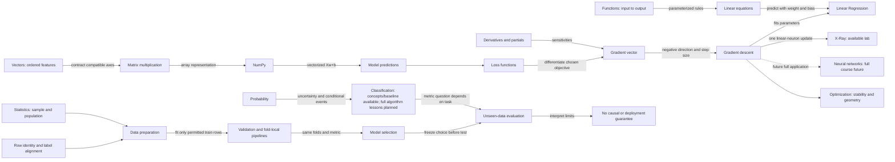

# Concept connections and contextual navigation

16 October2026. Proposed navigation metadata only, not new lessons, prerequisite locks, mastery equivalence or curricular authorization. Current approved objective IDs remain canonical; a future implementation must bind each displayed concept to existing lesson/objective metadata and a verified route.

## Connection vocabulary

- **Recall:** helps explain this concept; optional refresher, not enforced prerequisite.
- **Uses:** one concept supplies a representation/operation in another.
- **Applies in:** a concrete model/workflow uses the concept.
- **Caution:** limits an interpretation or invalidates a workflow.
- **Future application:** conceptually relevant but no full available curriculum; display future status and no course launch action.

Edges must contain a short “why,” not just module arrows. Related topics are not alternative evidence: a passed NumPy check does not confer Math mastery, and an X-Ray completion does not confer neural-network-course mastery.

## Concept dependency / relationship map

“Functions→linear equations” is a useful concept pathway, not a claim every function is linear. Some arrows are uses/recall relationships rather than a strict mathematical prerequisite DAG. Classification here includes existing Probability/Statistics intuition and sklearn most-frequent baseline; it does not advertise an implemented Logistic Regression module.

## Route-backed edge inventory

| Source → destination | Relation / why | Existing entry / status |
|---|---|---|
| Functions → equations |Recall input/output meaning and solve a parameterized linear relation. |/math/algebra-functions/functions → /math/algebra-functions/variables; both available.|
| Equations → Linear Regression |Applies in: learned weight/bias turns inputs into predicted targets; fitting differs from solving one equation. |/learn/linear-regression/equation, available.|
| Vectors → dot products |Uses paired components to form a weighted sum. |/math/vectors-dot-product, available.|
| Dot products → matrix products |Uses contractions to produce ordered predictions for multiple observations. |/math/matrices-multiplication and /math/linear-algebra, available.|
| Matrix products → NumPy predictions |Uses explicit axes/shapes and Xw+b, not elementwise multiplication by default. |/python/numpy/n04 and /python/numpy/n05, available.|
| Predictions → residual/loss |Compare prediction with the correctly paired target; state units and denominator. |/learn/linear-regression/errors, available.|
| Derivatives → partials/gradients |Recall sensitivity with respect to one parameter while holding others fixed; collect components at one state. |/math/derivatives, available; select current existing internal topic, no invented deep-link.|
| Loss → gradients |Uses derivative of the selected objective; different loss/normalization changes the gradient. |/math/optimization/objectives and /learn/linear-regression/gradient-descent, available.|
| Gradients → gradient descent |Uses minus-gradient direction with an explicit step size; not a promise of lower loss at any rate. |/math/optimization/updates, available.|
| Gradient descent → optimization |Caution: scaling, stability and finite-run evidence limit convergence claims. |/math/optimization/geometry and /math/optimization/stability, available.|
| Gradient descent → Linear Regression |Applies in: learn coefficients to reduce training objective; evaluate separately. |/learn/linear-regression/gradient-descent, available.|
| Gradient descent → neural networks |Applies in one existing linear-neuron trace; future full models compose many learned layers. |/demo available; full neural-network curriculum future/unscoped.|
| Update sign → debugging |Caution: addition of a gradient can be ascent; diagnose through changed loss and verify repair. |/challenges/wrong-direction, available.|
| Probability → classification |Recall uncertainty/events before interpreting class probabilities; a score alone is not calibrated uncertainty. |/math/probability and /python/sklearn/s02 baseline/metric reasoning available; full classifiers planned.|
| Statistics → causal caution |Caution: paired correlation/visual pattern does not identify intervention effects; confounding can explain association. |/math/statistics/relationships and /python/visualization/v03, available.|
| Statistics → preparation |Uses denominator/population reasoning when dropping/filling observations; missing is not zero. |/python/pandas/d03 and /python/preparation/t02, available.|
| Python paired records → pandas alignment |Uses stable observation identity instead of matching lengths; labels may reorder/arithmetic align. |/python/essentials/p06 → /python/pandas/d02, available.|
| Joins → evaluation |Caution: duplicate joins change observation weights and can leak customer identity across splits. |/python/pandas/d05 → /python/preparation/t01, available.|
| Preparation → validation |Uses train-only fit, saved transform and fold-local learned state; global imputation/scaling leaks. |/python/preparation/t05 → /python/sklearn/s03 and /python/sklearn/s04, available.|
| Validation → selection |Uses comparable folds/metric to choose without final-test feedback. |/python/sklearn/s05, available.|
| Selected workflow → unseen evaluation |Applies chosen/refit pipeline once to untouched final-test rows; state limitations. |/python/sklearn/s05 and /learn/linear-regression/failure-modes, available.|
| ML workflows → projects |Applies schema/split/metric reasoning in existing guided bridge; full studios/capstones remain planned. |/learn/linear-regression/project available with narrow label.|
| Projects → deployment/MLOps |Future application: operating a model adds deployment, monitoring and maintenance concerns. |No learner route or approved implementation scope; informational future node only.|

## Gradient-descent contextual panel

When a learner opens the Regression gradient-descent lesson:
- **You are here:** adjusting model parameters to reduce a training loss.
- **Why it matters:** the gradient tells how loss responds; the learning rate controls update distance.
- **Refresh first (at most two):** derivatives/partials and the exact loss definition, with one-sentence relevance.
- **See the bigger picture:** Optimization explains stability/scaling; Regression applies updates to coefficients; X-Ray applies the same ideas to one linear neuron. Full neural-network curriculum is future, not an available course.
- **Return:** after optional refresher, a normal link returns to the original lesson without resetting its controls/evidence or awarding progress.
- **Guard:** fitting/training-loss improvement is not unseen-data performance, causation or a convergence guarantee.

[Visual concept view](../outputs/homepage-journey-audit/gradient-descent-connections.svg) has a text-equivalent inventory above. Future graph interactions must offer keyboard-accessible node lists and relation text; panning/dragging cannot be the only route.

## Metadata and review boundary

Proposed edge fields: stable navigation-only concept key, existing objective/lesson references, source/target verified route, relation type, concise explanation, availability and author-review status. No formulas or grading logic live in graph metadata. Reuse canonical concept names, but do not treat a similarly named objective in another module as automatically equivalent. New edges/copy require mathematical and editorial review; new lessons, refreshers, diagnosis tests or progress migrations remain separately scoped.

