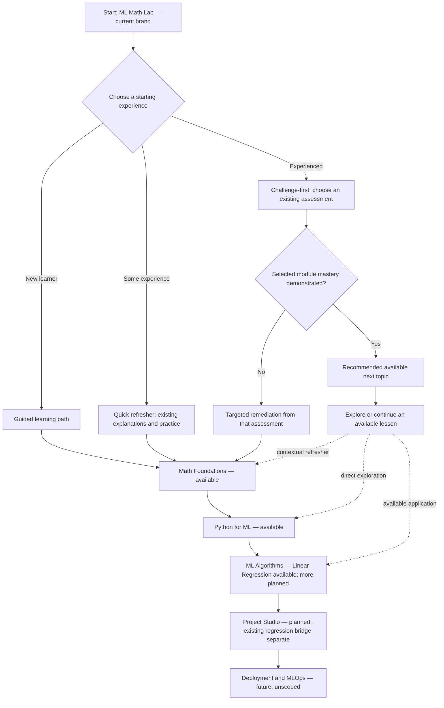

# Learning Journey Dashboard — proposed design specification

## Homepage learning journey — implemented, founder review pending

16 October2026. Founder authorized the bounded implementation. **Homepage/navigation are implemented; awaiting founder review**, not deployment or full accessibility acceptance. [Completion report](HOMEPAGE_LEARNING_JOURNEY_COMPLETION.md), [frozen implementation decisions](homepage-learning-journey-implementation-decisions.md) and [actual production-preview evidence](../outputs/homepage-implementation/) supersede earlier “design only/not authorized” status below, which remains historical.

Root / is the journey dashboard; logo returns home; Help contains Beta Guide; Challenges retains X-Ray/debugging. One Start/Continue action reads supported saved work without writes, migrations, mastery transfer or invented percentages. Five stages distinguish available/partial/planned/future content. Optional entry modes and five concept pathways reuse available lessons and native assessments.

Final verification:480 frontend/TypeScript tests in81 files,919 Python tests, typecheck and production build passed. Keyboard, browser history, genuine saved-practice/draft continuation and320px states were exercised on an isolated loopback origin. Original runtimes, scoring/evidence/persistence models, fixtures, notebooks and dependencies are unchanged. No subsequent major task, new curriculum or deployment.

**OPEN:** genuine screen-reader, genuine200%/400% browser zoom and genuine Colab. Comprehensive pedagogy and later authorized learner testing remain outstanding. Local/viewport checks do not close these gates.

### Approved design → actual implementation

This document's proposal/wireframes below remain the design baseline, not current production screenshots. The founder's later implementation authorization approved bounded orientation/navigation, read-only continuation, optional existing-content entry and requested concept connections. Actual choices/limitations are frozen in the linked implementation-decisions document. No permanent navigation/profile storage, universal assessment, prerequisite lock, new condensed lessons or future-stage routes were added.

16 October2026. **Proposal, not implemented.** Existing routes/evidence stay unchanged until a separately approved implementation task. The five stages below organize discovery; they add no curriculum, certifications or prerequisite locks.

## 1. The first-screen contract

Answer three questions in order:
1. **Where am I?** A validated current focus or honestly labeled suggested starting stage, not an invented learner level.
2. **Why am I learning this?** One concept-specific sentence connecting the next action to building/evaluating a model.
3. **What should I do next?** One prominent action; optional change-starting-point/refresher/challenge choices are secondary.

New visitor example: “Suggested start: Math Foundations. Learn how features become predictions. Start variables and equations.” Returning example: “Python for ML / pandas. Aligned rows keep targets attached to the right features. Continue D02.” Experienced example after an explicit choice: “Check NumPy understanding. Demonstrate shape and prediction reasoning. Open the existing independent NumPy assessment.”

Do not show a fictional progress percentage, claim mastered topics from visits, or call an ordering heuristic “personalized diagnosis.” Wireframes depict a clearly labeled **illustrative returning learner**, not actual stored user progress.

## 2. Information architecture and truthful availability

| Journey stage | Purpose | Current status | Available entry / limitation |
|---|---|---|---|
| Math Foundations |Understand the mathematical language of ML. |Available; full quality acceptance still open. |/math; six subjects plus integration.|
| Python for ML |Implement mathematical concepts reliably in code. |Available; six modules, local notebook evidence; AT/zoom/Colab open. |/python; Essentials→NumPy→pandas→Visualization→Preparation→scikit-learn.|
| ML Algorithms |Understand, train and evaluate models. |**Partly available**, not a completed algorithm track. |/learn/linear-regression; other approved algorithms remain planned. X-Ray is a small application lab, not a complete neural-network course.|
| Project Studio |Build complete ML solutions. |**Planned** full studio/engine and production capstones. |Existing /learn/linear-regression/project is a limited guided housing bridge, labeled separately; no “Open Studio” action.|
| Deployment and MLOps |Deliver, monitor and maintain models. |**Future / unscoped** curriculum aspiration; no route/course or V1 delivery promise verified. |No launch link, ETA, completion percentage or inferred authorization. Product deployment tasks are not a learner MLOps curriculum.|

Use four distinct dimensions: availability (available/partial/planned/future), implementation verification (what was actually tested), lesson completion and independent mastery. Never encode these all as a green check. Planned content appears as informative text, not a clickable fake lesson or disabled mystery control. “View plan” may reveal inline scope text; it must not navigate to an absent route.

Top navigation proposal: brand→Journey, Browse topics, Resources, Help. Existing destinations remain reachable through these groups with meaningful labels. No search, account, leaderboard, streak, billing surface or new course is needed for this design.

## 3. Components and hierarchy

| Component | Content / behavior | Priority |
|---|---|---|
| Welcome / current focus |Concise heading, current/suggested stage and module. “No saved progress found in this browser” differs from “could not read progress.” |First screen.|
| Why / next-action card |One concept-to-model explanation; one primary Start/Continue/Open assessment CTA; optional change-starting-point disclosure. |First screen; not competing primary cards.|
| Evidence summary |Plain lesson state and module mastery state; per-module valid denominator only. Link to native details. No whole-platform mastery score. |Beside card on desktop; beneath action on mobile.|
| Visual roadmap |Five staged nodes with short purpose/status. Desktop row; mobile ordered vertical list. Select an available stage to expose its actual modules, not automatically navigate/train. |Below primary card.|
| Connected concepts |At most two relevant refreshers, current concept and one application/next-topic explanation. “Why this connection?” disclosure; return-to-topic action. |Contextual, not a full graph by default.|
| Resources |Experiments, debugging and module notebooks grouped as tools, not competing main stages. Link to original P01 separately. |Compact area/disclosure.|
| Help / Getting started |Choose starting point, explain completion versus mastery, local-browser persistence limitation, beta guide. |Small secondary area.|

Suggested primary copy changes with state: Start learning (no evidence), Continue [specific lesson] (valid unfinished activity), Resume assessment (valid active draft), Review [specific critical concept] (confirmed failed gate), Explore [available next topic] (no unfinished target). Never silently open or submit an assessment from a recommendation.

“Change starting point” reveals three secondary choices: “Guide me from the fundamentals,” “Give me a focused refresher,” and “I already know this — check my understanding.” The last choice opens a chooser of existing independent module assessments, never an automatic skip/mastery action. Keep only the currently recommended action visually primary.

## 4. Desktop and mobile wireframes

- [Desktop PNG](../outputs/homepage-journey-audit/wireframe-desktop.png) / [accessible SVG](../outputs/homepage-journey-audit/wireframe-desktop.svg).
- [Mobile PNG](../outputs/homepage-journey-audit/wireframe-mobile.png) / [accessible SVG](../outputs/homepage-journey-audit/wireframe-mobile.svg).
- [Gradient-descent concept view](../outputs/homepage-journey-audit/gradient-descent-connections.png); detailed text/edges in the [concept map](homepage-concept-map.md).

These are static design artifacts, not functional prototypes or evidence of implemented responsiveness. Desktop uses existing panel/color/type language. Mobile preserves the orientation→why→one action order; the stage graph becomes a list without horizontal panning. Small stage labels in these low-fidelity drawings must meet the production type/contrast requirements below, not be copied pixel-for-pixel.

## 5. Visual journey

The founder's diagram is preserved as a **conceptual**, optional journey. “Mastery demonstrated” means only the selected existing module's own assessment, not a global diagnostic, transferable credit or authorization to unlock unbuilt courses.

The return-to-Math arrow is illustrative: failed pandas/ML checks return to their own targeted lesson unless Math recall is actually relevant. Planned/future arrows communicate the long-term idea, not navigable or mastery-locked steps. The interactive design must support direct available-topic entry regardless of the diagram order.

## 6. Guided / refresher / challenge-first interaction

| Experience | Entry and behavior | Unchanged evidence contract |
|---|---|---|
| Guided |Default suggestion for new visitors; existing full lesson explanation→worked example→experiment/practice→optional native assessment. |Existing lesson completion checks and independent mastery only.|
| Refresher |Show existing overview/recall/worked example and direct links to focused existing practice. “Expand full explanation” remains available. |No new condensed curriculum, shortened assessment or evidence equivalence. New summaries would need educational review.|
| Challenge-first |Learner chooses an available module, sees its native objectives/gates/threshold and explicitly opens that module's existing assessment. Failure offers native targeted remediation; success recommends another available topic. |Exactly the current forms, attempts, confirmation, retry and critical gates; no bypass or new universal placement score.|

Mode selection is optional and reversible, never an inferred ability label. A learner may revisit full explanations after passing or enter an advanced topic without taking a diagnostic. No permanent ability profile, new event tracking or settings storage is authorized. For initial implementation proposal keep choices in page/session memory; persistent preferences/last-visited records require a separately approved bounded schema, not changes to existing evidence.

## 7. Proposed recommendation and progress-read contract

This is a proposal for a future implementation specification, not a new persistence model.
1. Read only an explicit allowlist of existing module codecs/scopes. Hydrate before deriving a UI state. Never scan arbitrary localStorage, rewrite raw records, migrate versions, reset corruption or award evidence.
2. Return per-scope known/unsupported/unreadable status. Valid no-evidence is not the same as read failure. If storage is unavailable, show browse/start fallback and “Progress could not be read”; do not show zero progress.
3. Honor a current in-page topic choice first. An actual unfinished assessment may be offered as “Resume assessment,” with its existing review/confirmation behavior. A reassessment remains labeled reassessment after prior mastery.
4. If validated records expose comparable relevant activity timestamps, rank only those records by actual recorded activity, not claimed last visit. Otherwise label the result “Suggested continuation” in stable approved curriculum order; offer “Choose another topic.” Do not infer recency for drafts without a timestamp.
5. For confirmed critical failures, surface the native failed objective/remediation target without exposing active-attempt correctness. Previously earned mastery remains visible after a later failure.
6. With no usable unfinished target, recommend a first available unmastered topic, considering optional prior-knowledge choice and relevant recall. This is guidance only; no route lock or learned evidence aggregation. All available topics remain browsable.
7. With all available targets demonstrated, offer review/transfer practice or the existing bridge, not an unbuilt course, forced reset or invented track award.

No additional cross-module imports. The approved P01 copy remains explicit preview/opt-in at its current overview. Do not silently use it to inflate dashboard completion. Partial/malformed/foreign records stay untouched; display source-specific unknown states. Freeze exact recommendation ordering, timestamp availability and adapter tests before coding. If durable “last opened” resume is wanted, founder must approve new navigation metadata separately.

## 8. Navigation and route mapping

| Proposed label / role | Existing route or proposed behavior | Status |
|---|---|---|
| Journey / brand |Propose / replacing the current redirect; /demo remains. |Approval required; no change now.|
| Getting started / Beta Guide |/beta; preserve experiment-specific onboarding/feedback. |Available.|
| Math / first fundamentals |/math; /math/algebra-functions/variables. |Available.|
| Functions refresher |/math/algebra-functions/functions; equations at /math/algebra-functions/variables. |Available.|
| Vectors / matrix products |/math/vectors-dot-product; /math/matrices-multiplication; full /math/linear-algebra. |Available; legacy experiences remain.|
| Calculus / gradients |/math/derivatives; existing internal modules remain controlled by that page. |Available; do not invent unsupported query/deep-link state.|
| Losses / gradient updates |/math/optimization/objectives; /math/optimization/updates. |Available.|
| Python track |/python; /python/essentials; /python/numpy; /python/pandas; /python/visualization; /python/preparation; /python/sklearn. |Available.|
| Current illustrative lesson |/python/pandas/d02. |Available.|
| Full Essentials P01 / original pilot |/python/essentials/p01/module versus /python/essentials/p01. |Both available; keep evidence distinction.|
| Python module challenge |/python/{approved-module}/mastery for exactly the six modules above. |Available; not arbitrary path interpolation.|
| Algorithm entry / training |/learn/linear-regression; /learn/linear-regression/gradient-descent. |Available.|
| Regression challenge / bridge |/learn/linear-regression/mastery; /learn/linear-regression/project. |Available; bridge is not full Project Studio.|
| X-Ray experiment / wrong-direction challenge |/demo; /challenges/wrong-direction. |Available, retained.|
| Notebooks |Existing download links from the owning Math/Regression/Python lesson/module. Python six filenames /notebooks/python-{essentials,numpy,pandas,visualization,preparation,sklearn}.ipynb. |Available; no execution/mastery claim.|
| Full projects / other algorithms |Inline planned scope only; no invented /projects or /algorithms route. |Planned.|
| Deployment and MLOps |Inline future/unscoped description, no launch route. |Future.|

Future navigation implementation should preserve direct URLs/bookmarks, module reset boundaries, browser Back/Forward and return-to-topic navigation. A validated in-memory return target must be an allowlisted internal route; no arbitrary external return URL or assessment auto-submit. Expose lesson titles with codes secondary, not unexplained P01/D02-only labels.

## 9. Accessibility and responsive requirements

- Real headings/landmarks, skip link and predictable DOM order matching visual hierarchy; descriptive links and visible keyboard focus. No drag/hover/color-only navigation.
- Roadmap available as an ordered text list plus accessible details, not only SVG/canvas. Each connection states source, relation and destination. Diagram is optional enhancement.
- Available stages use actual links/buttons; planned/future stages use status text and optional inline details. Native disclosure controls expose expanded state; Escape closes overlays and focus returns. No mandatory modal onboarding.
- At320px: one column, wrapping labels, no document overflow; do not require two-dimensional graph panning. Verify200%/400% real browser zoom separately. Aim44×44px actionable targets; no hover-only tooltips.
- Readable body type (target16px), captions at least14px in production, contrast4.5:1 for ordinary text/3:1 large text and UI components, focus not obscured; test actual token combinations rather than assuming brand colors pass.
- Do not announce every hydration update. Concise polite status for restored progress/unavailable storage; retain focus. Never read active assessment answers into a global summary or expose answer keys.
- Respect reduced motion; no animated graph requirement. All long labels/translations wrap.
- Test actual screen-reader speech/navigation for stage status, progress versus mastery, controls, concept edges and return focus. Genuine reader, real zoom and Colab remain open; static drawings are not verification.
- Production acceptance requires desktop/mobile browser checks and regression suites after approved code changes. No such redesign acceptance is claimed now.

## 10. Scenario walkthroughs — expert evaluation, not learner testing

| Learner | First useful action / why | Alternatives and protections |
|---|---|---|
| Technical writer, limited programming |Guided suggested Math variables/functions; why features and prediction rules matter; then Python Essentials with units/types. |Choose Python directly; no engineer-only welcome or assumption that “can read code” applies.|
| Software engineer transitioning to ML |Choose refresher or challenge-first; select NumPy/preparation assessment, see why shape or leakage affects predictions. |Math refresher linked contextually; passing an assessment alone awards only its existing scope.|
| Student beginning with mathematics |Start variables/equations; visible vectors→matrices→code pathway explains purpose before syntax. |Freely explore probability/statistics; no mandatory sequence lock.|
| Returning learner |Validated focus and one specific Continue/Resume target, separate completion/mastery and browser-local limitation. |Multiple unfinished scopes: honestly labeled suggestion with chooser; unsupported record is not reset or presented as zero.|
| Experienced learner skipping explanations |Open an existing module challenge; native critical gates still apply; targeted explanation follows failure. |Skipping does not award mastery; can expand full lesson or explore directly without diagnostic. |

These walkthroughs establish design intent and expose edge cases. “Answers within a few seconds” is a future founder/usability acceptance goal, not a measured claim or authorization for external testing.

